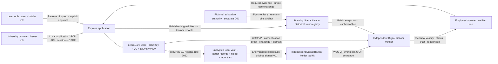

# Architecture and security boundaries

**Standards-based artifacts:** VC 2.0 JSON-LD; DataIntegrityProof with eddsa-rdfc-2022; W3C VP; did:key Ed25519 identifiers; BitstringStatusListCredential/Entry; Schema.org education semantics. The JSON Schema and trust registry extension are this implementation’s profile, not a finalized ITU schema.

**LearnCard-specific interfaces:** generateLearnCard/addPlugin, getDidKitPlugin, getDidKeyPlugin, getVCPlugin, id.did, invoke.issueCredential and invoke.issuePresentation.

**Application-specific interfaces:** the Express issuance/receipt/consent/request/status/backup APIs. This is not OpenID4VCI/VP or a standards-certified VC API. Signed artifacts can be taken out and verified by independent libraries without the issuer application.

## Keys and persistence

Issuer, holder and fictional authority have distinct random 32-byte seeds. LearnCard derives Ed25519 keys and self-contained did:key documents. The independent verifier derives DID documents using Digital Bazaar’s driver rather than using LearnCard resolution or an issuer key endpoint. did:key does not provide key rotation or institution accreditation by itself.

The LearnCard WASM artifact is loaded from the pinned npm package. A SHA-256 integrity check matches the published fe1d2541…3f1bd62 digest; no remote WASM/context loading occurs during operations.

The development vault uses Node’s AES-256-GCM with authenticated metadata and serialized atomic writes. File modes are 0700 for private directories and 0600 for key/vault files. Issuer records retain original signed credentials and status indices. Revocation is permanent; suspension is reversible. Recovery only restores holder data against the original issuer records; it cannot reset revocation or recreate an issuer database.

A local backup uses scrypt and AES-256-GCM with a random salt and nonce. It contains the full seed encrypted by the backup password. It is separate from LearnCard’s documented holder-continuity ZIP format. The independent toolkit receives the recovered seed solely in a local test to preserve subject binding; no private keys are logged or included in examples.

## Verification and trust

The independent verifier checks the exact allowed academic JSON-LD context/schema, cryptographic proof, dates, signed status lists, historical issuer scope and a separate employer recognition policy. Status lists contain 131,072 bits and no learner attributes. A separate fictional authority signs the registry; the verifier’s anchor is an operator-selected DID. A production authority can replace the registry publisher and provision its anchor through independently governed configuration.

Verification reads published snapshots, not live learner or issuer records. Status/trust snapshots last 24 hours and refresh hourly while the server runs. Without a fresh cache, verification fails closed. Offline status is bounded by cache age, not an assertion of instantaneous revocation.

## Access and privacy

Three password-authenticated roles use expiring HttpOnly/SameSite=Strict session cookies. Mutations require CSRF tokens and accepted origins. Role checks separate issuance, receipt, backup and verification. Development defaults are visible and intended only for local synthetic demonstrations; a non-loopback bind requires configured passwords.

Employer requests expire in five minutes, have random challenges and domain binding, and can be verified once. Full disclosure requires explicit holder approval of the displayed credential set and digest. No selective disclosure is claimed. The employer has no credential database; pending presentations exist in memory only until verification/expiry. Request bodies and cryptographic keys are not logged. Results omit learner attributes.

This single-process development topology is not tenant isolation. The host administrator has custody of all keys, vault files and application memory. Production requires learner-controlled custody, managed secrets/HSMs where appropriate, independent services, HTTPS, stronger authentication, operational audits and governance. No production security attestation has been performed.
